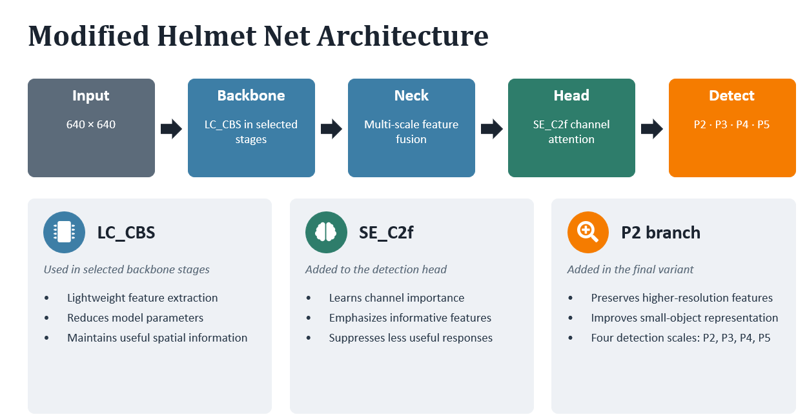
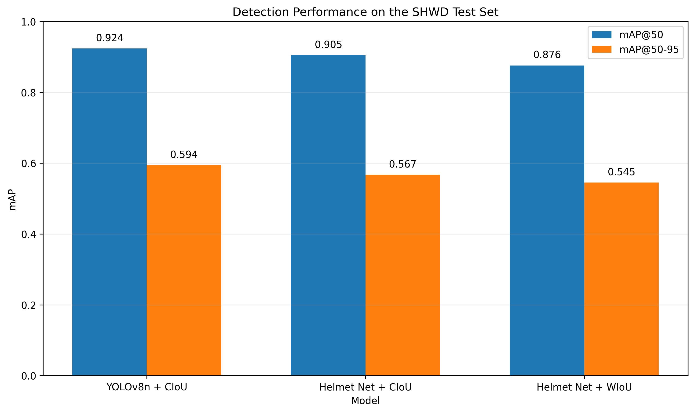
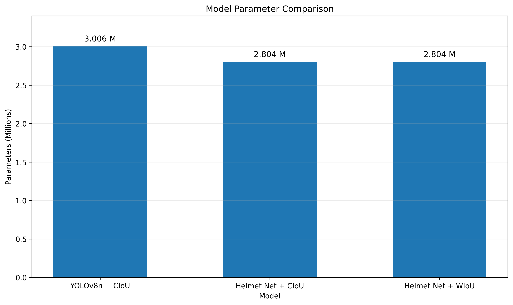
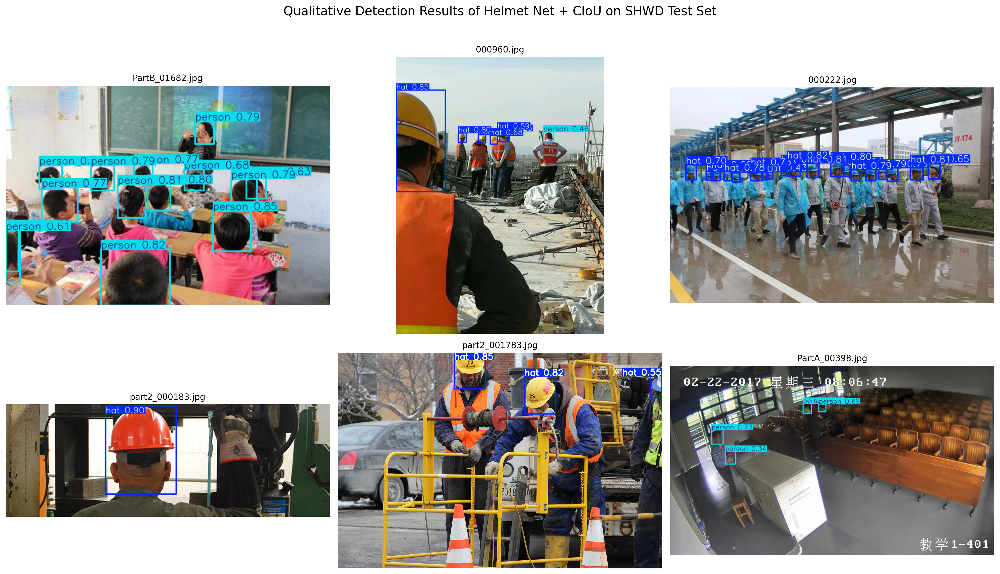

# Lightweight Helmet Detection Using Modified YOLOv8

An experimental study on lightweight architectural modifications, attention mechanisms, and multi-scale detection using the **Safety Helmet Wearing Dataset (SHWD)**.

## Overview

This project investigates modifications to YOLOv8 for safety helmet and person detection. The objective is to evaluate whether architectural changes can reduce model complexity while maintaining detection performance.

The experiments explore:

- **LC_CBS:** Lightweight feature extraction module.
- **SE_C2f:** Channel attention-based feature refinement.
- **WIoU:** Alternative bounding-box regression loss.
- **P2 Detection:** High-resolution feature detection branch for improved small-object detection.

The models were implemented and evaluated using the SHWD dataset.

## Architecture

The modified architecture integrates LC_CBS modules into selected backbone layers and uses SE_C2f for feature refinement. A separate experiment adds a P2 detection branch alongside the existing P3, P4, and P5 detection scales.



### Main Components

**1. LC_CBS**

A lightweight feature extraction module involving feature projection, gating, depthwise convolution, batch normalization, and SiLU activation.

**2. SE_C2f**

Combines C2f feature extraction with Squeeze-and-Excitation channel attention to recalibrate feature channels.

**3. P2 Detection Branch**

Adds a higher-resolution detection scale to improve the detection of smaller objects. It increases computational requirements compared with the model without P2.

## Dataset

**Safety Helmet Wearing Dataset (SHWD)**

- Total images: 7,581
- Classes: `hat` and `person`
- Hat bounding boxes: 9,044
- Person bounding boxes: 111,514

### Dataset Split

| Split | Images |
|---|---:|
| Training | 5,457 |
| Validation | 607 |
| Testing | 1,517 |
| **Total** | **7,581** |

The original Pascal VOC annotations were converted into YOLO format for training and evaluation.

Dataset source: [Safety Helmet Wearing Dataset (SHWD)](https://github.com/njvisionpower/Safety-Helmet-Wearing-Dataset)


## Experimental Setup

| Parameter | Configuration |
|---|---|
| Base Model | YOLOv8n |
| Image Size | 640 × 640 |
| Epochs | 100 |
| Batch Size | 16 |
| Optimizer | AdamW |
| Learning Rate | 0.001 |
| Random Seed | 42 |
| Hardware | NVIDIA Tesla T4 GPU |
| Framework | PyTorch and Ultralytics YOLOv8 |

## Experimental Results

The following table compares the baseline and modified model configurations.

| Model | Parameters | GFLOPs | Precision | Recall | mAP@50 | mAP@50–95 |
|---|---:|---:|---:|---:|---:|---:|
| YOLOv8n + CIoU | 3.006M | 8.1 | 0.9200 | 0.8700 | 0.9240 | 0.5940 |
| Helmet Net + CIoU | 2.804M | 8.2 | 0.9134 | 0.8419 | 0.9048 | 0.5671 |
| Helmet Net + WIoU | 2.804M | 8.2 | 0.8886 | 0.8135 | 0.8760 | 0.5452 |
| Helmet Net + P2 + CIoU | 2.719M | 12.3 | 0.9131 | 0.8595 | 0.9208 | 0.5830 |

## Performance Visualizations

### Detection Performance



### Model Parameter Comparison



### Computational Complexity


### Per-Class Performance


### Qualitative Detection Results



## Key Findings

- The modified Helmet Net architecture reduced parameters from **3.006M to 2.804M**, approximately a **6.73% reduction** compared with the YOLOv8n baseline.
- The tested WIoU configuration did not improve detection performance over the corresponding CIoU configuration.
- Adding the P2 detection branch improved mAP@50–95 from **0.5671 to 0.5830** compared with Helmet Net + CIoU.
- The P2 configuration also improved recall from **0.8419 to 0.8595**.
- However, P2 increased computational complexity from **8.2 to 12.3 GFLOPs**.
- The original YOLOv8n baseline achieved the highest mAP@50–95 of **0.5940** among the evaluated configurations.

These experiments demonstrate the trade-offs between model size, computational cost, and detection performance.

## Technologies Used

- Python
- PyTorch
- Ultralytics YOLOv8
- OpenCV
- NumPy
- Matplotlib
- Kaggle GPU Environment

## Repository Structure

```text
Helmet-Detection-YOLOv8/
│
├── README.md
├── notebooks/
│   └── Helmet_Detection_Implementation.ipynb
│
├── report/
│   ├── Helmet_Detection_Report.pdf
│   └── Helmet_Detection_Report.docx
│
├── presentation/
│   └── Helmet_Detection_Presentation.pdf
│
├── architecture/
│   └── proposed_architecture.png
│
└── results/
    ├── figure1_detection_performance_updated.png
    ├── figure2_parameter_comparison_updated.png
    ├── figure3_gflops_comparison_updated.png
    ├── figure4_per_class_performance_updated.png
    └── qualitative_detection_results.png
```

*The structure above is a suggested layout. Include only files that are actually present in the repository.*

## Implementation

The complete implementation and experimental workflow are documented in the Jupyter Notebook:

[Helmet Detection Implementation Notebook](notebooks/Helmet_Detection_Implementation.ipynb)

## Reference Paper

Deng, Li, Jin Zhou, and Quanyi Liu. (2024).

**"Helmet Net: An Improved YOLOv8 Algorithm for Helmet Wearing Detection."**

International Journal of Networked and Distributed Computing, 12, 329–343.

[https://doi.org/10.1007/s44227-024-00040-1](https://doi.org/10.1007/s44227-024-00040-1)

---

**Project Focus:** Computer Vision | Deep Learning | Object Detection | YOLOv8 | Model Optimization
